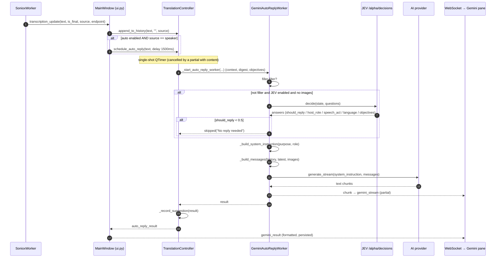
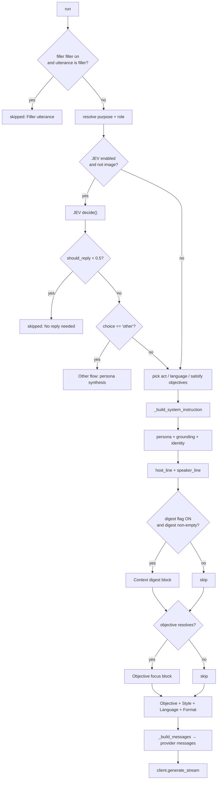

# AI Auto-Reply — Full Flow, Prompt Anatomy & Where Context Leaks

> Scope: the **auto-reply** pipeline only (voice reply + manual reply + screenshot reply).
> It does **not** cover bullet points, summary, consulting, last-pickup or objectives as
> *features* — only the parts of them that the reply prompt can actually see.
>
> Audited against the code at `src/gemini_worker.py`, `src/controllers/translation_controller.py`,
> `src/ui.py`, `src/decision_client.py`, `src/purposes.py`, `src/reply_context.py`,
> `src/ai_client.py`, `src/config.py`.

---

## 1. TL;DR

The pipeline is:

```
Soniox final speaker line
  → MainWindow._on_transcription_update
    → TranslationController.schedule_auto_reply   (debounce 1.5 s)
      → GeminiAutoReplyWorker.run()               (QThread)
        ├─ filler filter        (skip "Okay." / "Exactly.")
        ├─ JEV decision call    (optional gate: should_reply / role / speech act / language)
        ├─ _build_system_instruction  (persona + profiles + digest + objective + format)
        ├─ _build_messages            (history → user/assistant turns)
        └─ client.generate_stream     (Gemini or any OpenAI-compatible endpoint)
      → result / chunk signals → WebSocket → Gemini pane
```

Two phases decide whether that chain runs at all: the **scheduling** phase (the timer is
armed by `ui.py` and cancelled by any partial) and the **gating** phase inside the worker
(filler filter + optional JEV `should_reply`). §3.1–3.3 list every condition under which
the AI does *not* reply.

**The single most important finding for your "slop gap":**

The app computes a lot of high-value context — the rolling **bullet list**, the extracted
**KYC speaker profile**, the **confirmed client brief**, its own **prior suggestions**, the
**summary / gaps / roadmap** — but by default **almost none of it reaches the reply prompt**.

* The digest that would carry the bullets / KYC profile / brief / prior suggestions is gated
  behind `AUTO_REPLY_CONTEXT_DIGEST`, which defaults to **`false`** (`src/config.py`).
* The summary, gap analysis and roadmap are **never** wired into the reply path at all.
* So the model answers from (a) the last ≤25 raw turns and (b) the Host/Speaker profile
  files — both of which are often stale or wrong (see §11).

The reply is therefore "on-topic sounding" but built on the thinnest possible slice of the
session, which is exactly the symptom you describe.

---

## 2. Component map

| Layer | File | Responsibility |
|---|---|---|
| Capture | `src/workers.py` (`SonioxWorker`) | PCM → Soniox STT; emits `transcription_update(text, is_final, source, endpoint)` |
| Transcription fan-out | `src/controllers/transcription_controller.py` | re-emits the signal, owns host/speaker workers |
| UI orchestration | `src/ui.py` (`MainWindow._on_transcription_update`, `_manual_reply`, `_rebuild_reply_digest`) | debounce scheduling, history buffering, digest build, broadcast |
| Reply scheduling | `src/controllers/translation_controller.py` | debounce timer, one-worker-at-a-time + queued rerun, history cap, suggestion recording |
| Decision gate (optional) | `src/decision_client.py` + `src/speech_acts.py` | TypeSafe JEV `/alpha/decisions` for `should_reply`, role, acts, language, objectives |
| Prompt + AI call | `src/gemini_worker.py` (`GeminiAutoReplyWorker`) | prompt assembly, message building, streaming |
| Persona seed | `src/purposes.py` + `src/purpose_store.py` | purposes/roles/styles; `purposes.json` holds user/learned overrides |
| Digest | `src/reply_context.py` | pure builder for the optional `Context digest:` block |
| Provider | `src/ai_client.py` | Gemini SDK or any OpenAI-compatible `chat.completions` endpoint |
| Display | `websocket-server/public/hooks/*`, `components/GeminiDisplayer.js` | renders `gemini_stream` / `gemini_result` |

---

## 3. End-to-end flow (voice auto-reply)

1. **Utterance ends.** `SonioxWorker` emits a final with `endpoint=True` when the Soniox
   `<end>` token is present (endpoint detection tuning: `SONIOX_MAX_ENDPOINT_DELAY_MS=800`,
   `SONIOX_ENDPOINT_LATENCY_ADJUSTMENT_LEVEL=2`, `SONIOX_ENDPOINT_SENSITIVITY=0.4`).
2. **`MainWindow._on_transcription_update`** (final branch):
   * appends `[SPEAKER] …` to the Live Window editor,
   * `translation_controller.append_to_history(text, "", source)` → conversation turn
     (`{"text","role","suggestion"}`), capped at `MAX_HISTORY_TURNS = 25`,
   * buffers the line into bullet points / objectives / last-pickup controllers (free),
   * persists to the session store,
   * **if `_auto_reply_enabled` and the line is from the speaker** → schedules a reply.
     * `endpoint=True` → `AUTO_REPLY_ENDPOINT_DEBOUNCE_MS` (1500 ms)
     * otherwise → `AUTO_REPLY_DEBOUNCE_MS` (1500 ms)
   * If a **non-final** partial arrives with content, the pending timer is **cancelled**
     (`cancel_auto_reply`).
3. **`TranslationController.schedule_auto_reply`** stores the pending text, restarts a
   single-shot `QTimer`.
4. On timeout → **`_trigger_auto_reply`** → **`_start_auto_reply_worker`** creates a
   `GeminiAutoReplyWorker`, passing: pending text, target language, `conversation_history`
   (copy), pronunciation flag, purpose key, purpose_store, host role, JEV flag, the
   **mirrored context** (`self._context`), allow_filler, the **session digest**, and the
   **objectives/locks/meta**. If a worker is already running, one rerun is queued
   (`_rerun_pending`) instead of dropping the utterance.
5. **`GeminiAutoReplyWorker.run()`**:
   * **Filler filter** — if the utterance is only acknowledgments and it is not a manual
     request and there are no images → `skipped` ("Filler utterance"), no AI call.
   * **Resolve purpose → roles → role.** `_host_role == "smart"` or an unknown key falls
     back to `default_role_key(purpose)`.
   * **JEV gate** (only if enabled *and* not an image reply) → one `decide()` call:
     * `should_reply` < 0.5 → `skipped` ("No reply needed")
     * `host_role` (Smart mode) → adopt the choice if confidence ≥ `JEV_MIN_CONFIDENCE`
     * `speaker_act` → pins the act named in the analysis preamble
     * `speech_act == "other"` or low confidence → **Other flow** (persona synthesis)
     * `reply_language` → overrides detected/target language
     * `current_objective` → `objective_observed` signal (free tracker update)
     * `objective_N` nouls → indexes of already-met objectives (fed into the prompt)
   * **Build the system instruction** (`_build_system_instruction`, see §5).
   * **Build the messages** (`_build_messages`, see §7).
   * **Stream** (`client.generate_stream`) — coalesced partials at most every
     `AI_STREAM_CHUNK_INTERVAL_MS` (60 ms); final `result` emitted at the end.
6. **Result path:** `chunk` → `reply_chunk` → `MainWindow._on_reply_chunk` →
   `gemini_stream` frame; `result` → `auto_reply_result` → `_record_suggestion` (stamps the
   suggestion onto the answered speaker turn) → `_on_auto_reply_result` →
   `format_gemini_result` → `gemini_result` frame + persisted to `aireply_results`; then
   `_rebuild_reply_digest()` runs again.

### 3.1 Trigger & suppression — when the AI replies and when it stays silent

The reply is decided in **two phases**, and both must pass:

| Phase | Owner | Question |
|---|---|---|
| **Scheduling** | `MainWindow._on_transcription_update` + `TranslationController` | *Should a timer be armed at all, and does it survive?* |
| **Gating** | `GeminiAutoReplyWorker.run()` | *Once armed, is an AI call actually worth spending?* |

A single-shot `QTimer` is the only trigger: nothing calls the provider directly.

### 3.2 The debounce, concretely

Both debounce constants are **1500 ms** (`AUTO_REPLY_DEBOUNCE_MS` and
`AUTO_REPLY_ENDPOINT_DEBOUNCE_MS`), so the `<end>` path is *not* faster today — it only
takes a different branch and log line. Because Soniox streams partials while the speaker
keeps talking, and **any partial with content cancels the pending timer**, the debounce
effectively means *"the speaker paused for ~1.5 s"*:

```text
t=0.0  speaker final   "jadi brief-nya…"        → timer 1500 ms
t=0.4  speaker partial "jadi brief-nya masih"   → cancel (pending dropped)
t=0.9  speaker final   "…masih hilang ya"       → timer 1500 ms (text REPLACED)
t=2.4  timeout → worker starts → spinner → stream → result
```

Consequences that are easy to get wrong:

* **No utterance queue.** `schedule_auto_reply` overwrites `_pending_transcription`, so the
  reply always answers the **latest** final line; an earlier one is silently dropped.
* **An empty partial does not cancel.** That is why `SonioxWorker` emits `("", False, …)`
  when a chunk produced only finals — otherwise a pause would look like new speech.
* **A *host* partial with content cancels a pending speaker reply** (the non-final branch
  does not filter by source); a host *final* never cancels and never schedules.
* **The `Auto reply` toggle is not persisted** — it resets to `false` on every app start
  (`aireply-app.js` `useState(false)`, `MainWindow._auto_reply_enabled = False`), and is
  only changed by the pane's `auto_reply_toggle` control message.
* **Pane visibility is irrelevant**: the reply runs and is broadcast whether or not the
  Gemini pane is open (unlike Last Picked Up, which is a silent no-op while hidden).

### 3.3 Suppression table — every reason the AI does not answer

| # | Gate | Where | Effect / what the pane shows |
|---|---|---|---|
| 1 | `Auto reply` toggle off | `ui.py` (`_auto_reply_enabled`) | No timer is ever armed |
| 2 | Line came from the **host** | `ui.py` final branch | Recorded in history only, never a trigger |
| 3 | Empty text | `ui.py` final branch | Not scheduled |
| 4 | Non-final partial with content while the timer runs | `ui.py` non-final branch | Timer cancelled, pending **dropped** (not deferred) |
| 5 | A newer final arrives while the timer runs | `schedule_auto_reply` | Timer restarted; only the newest text is answered |
| 6 | Another reply worker is in flight | `_start_auto_reply_worker` | One `_rerun_pending` rerun after it finishes |
| 7 | Utterance is **only** acknowledgments | `gemini_worker.run` + `filler_filter.is_filler` | `skipped("Filler utterance")` → `gemini_status skipped` |
| 8 | JEV `should_reply < JEV_SHOULD_REPLY_MIN` | `gemini_worker.run` | `skipped("No reply needed")`; requires `JEV_ENABLED=true` |
| 9 | JEV `speech_act == "other"` / low confidence | `gemini_worker.run` | **Not** a skip — escalates to the Other flow (persona synthesis) |
| 10 | Pending text empty at timeout | `_trigger_auto_reply` | Silent abort |

The **filler filter lives in the worker, not in scheduling**, so the pane's title spinner
still flickers: `reply_activity(True)` fires when the worker starts, and `skipped`
immediately emits `reply_activity(False)`.

### 3.4 Manual paths bypass *some* gates, not all

`Ctrl+R`, the pane's **Reply now** (`auto_reply_request`) and `_manual_reply` all route to
`trigger_reply_now` → `_trigger_auto_reply(force=True)`:

* bypass the debounce (fires immediately), and
* bypass the filler filter (`allow_filler=True`),

but they do **not** bypass the JEV `should_reply` gate: the worker receives no "manual"
flag, so with `JEV_ENABLED=true` a confident `< 0.5` still suppresses a user-requested
reply.

### 3.5 "Last Picked Up" is not a trigger

The Last Picked Up tab is a **separate** pipeline with its own pair of debounce constants
(`LAST_PICKUP_DEBOUNCE_MS` / `LAST_PICKUP_ENDPOINT_DEBOUNCE_MS`, both 2000 ms). It never
schedules a reply and is not part of the reply prompt (see §9). Do not read "pickup" as
"the reply trigger".

### 3.6 Trigger granularity caveats

* The unit of triggering is the **last final line**, so a fragmented or interrupted
  utterance can fire on a sentence fragment (§11.6).
* Because scheduling is last-write-wins, a long monologue with few pauses produces **one**
  reply for the whole stretch, not one per sentence.
* With `AUTO_REPLY_CONTEXT_DIGEST=false` (default) the reply for that stretch is built from
  raw turns only — see §9 and §11.1.

---

## 4. Sequence diagram



---

## 5. Prompt anatomy — what the model actually receives

### 5.1 System instruction skeleton

`GeminiAutoReplyWorker._build_system_instruction` renders this (sections marked `[opt]` are
conditional):

```text
{persona}                                        ← role["persona"] (Purpose → role)

- Messages with role 'user' are what the other person (Speaker) said.
- Messages with role 'assistant' are what you (the Host) have said previously.
{grounding_rule}                                 ← 2 bullets if Host context, else anti-invention bullet
{identity_block}                                 ← "You are acting as…", counterpart, act directives
{host_line}                                      ← "- Host profile (pre-identified): …"  [opt]
{speaker_line}                                   ← "- Speaker profile: …" | "unknown; infer…"
{digest_block}                                   ← "Context digest:"  [ONLY if AUTO_REPLY_CONTEXT_DIGEST]
{objective_block}                                ← "Objective focus:" [opt, if a focus resolves]

Objective:                                       ← role["objective"] bullet lines
{style_section}                                  ← "Style:" approach/tone/length/answer_first/structure

Language:
- Write the Host's reply in {language}.           ← reply_language ?? detected ?? target
{analysis_rule}                                  ← "write the Speaker's move line in English…" [opt]
{detected_line}
- If the Speaker switches language, mirror the new dominant language.
- Label the reply's first line with that language's name (e.g. "Indonesian Text:").
- Adapt the syllables/pronunciation to the language you actually use…

Format your response exactly as follows:
{format_block}                                   ← "Speaker's move:" + "<Lang> Text:" + pronunciation + samples
{output_rule}                                    ← only when pronunciation is OFF
```

### 5.2 The conditional blocks

| Block | Built by | Appears when |
|---|---|---|
| `persona` | `role["persona"]` | always |
| `grounding_rule` | `_build_system_instruction` | two bullets if `self._self_context` non-empty; else the **anti-invention** bullet ("No profile of what the Host offers is available: do not invent product specifics…") |
| `identity_block` | `_build_system_instruction` | always; adds speech-act lines when there is an utterance |
| `host_line` | `self._self_context` | omitted entirely when the user selected **no** context for Host |
| `speaker_line` | `self._speaker_context` | always (falls back to "unknown; infer") |
| `digest_block` | `_digest_block` | `AUTO_REPLY_CONTEXT_DIGEST=1` **and** digest non-empty |
| `objective_block` | `_objective_block` | `resolve_active(...)` returns a focus (locked objective or committed prediction) |
| `style_section` | `_style_block` | always (roles without a `style` fall back to `DEFAULT_ROLE_STYLE`) |
| analysis preamble | `_analysis_prompt_lines` | voice replies only (no utterance for image replies) |

### 5.3 The `Context digest:` block (when enabled)

`src/reply_context.py::build_digest` → `_digest_block` renders at most:

```text
Context digest:
Conversation points so far:
- [locked] <locked bullet>
- <rolling bullet>                     ← last AUTO_REPLY_MAX_BULLETS = 20
Extracted Speaker profile:
- Name / Occupation
- Goals / Pain points / Facts          ← ≤ AUTO_REPLY_MAX_PROFILE_ITEMS = 5 each
Confirmed client brief:
  <brief lines>                        ← ≤ AUTO_REPLY_MAX_BRIEF_CHARS = 1200
Already suggested (do not repeat these):
- <prior suggestion>                   ← last AUTO_REPLY_MAX_PRIOR_SUGGESTIONS = 3
```

Per-item truncation is `AUTO_REPLY_MAX_BULLET_CHARS = 160`.

### 5.4 Prompt assembly flow



---

## 6. The JEV decision gate (optional)

`JEV_ENABLED` defaults to **`false`**; `DecisionClient.available` also requires a key and a
base URL, so an unconfigured install is a pure no-op (the reply still happens).

One POST to `{JEV_BASE_URL}/alpha/decisions` with `{model, state, questions}`. `state` carries:
`host_profile`, `purpose`, `host_role`, `recent_turns` (last 6), `latest_utterance`, plus
`speaker_profile` / `objectives` / `active_objective` when present.

Questions built by `build_questions`:

| Question | Type | Effect on the reply |
|---|---|---|
| `should_reply` | noul | < `JEV_SHOULD_REPLY_MIN` (0.5) → **skip the reply** |
| `host_role` | choice | Smart mode only; ≥ `JEV_MIN_CONFIDENCE` (0.55) → adopts the role |
| `speaker_act` | choice | pins the Speaker's act in the analysis preamble |
| `speech_act` | choice | Host's act; `other` or low confidence → **Other flow** |
| `reply_language` | choice | overrides the detected/target language |
| `current_objective` | choice | free objective-tracker observation |
| `objective_0…N` | noul | ≥ `JEV_OBJECTIVE_MET_MIN` (0.7) → "Already met" line |

When JEV is **off** (your default): no `should_reply` gate, role = purpose default, no act
hint, and the model is left to classify the speech act itself from a bare list — a known
source of generic replies.

---

## 7. Message building (`_build_messages`)

The conversation history is normalized into provider-neutral
`{"role": "user"|"assistant", "text", "images?"}`:

1. Empty turns dropped.
2. **All leading host turns dropped** (the list must start with a `user` turn).
3. The trailing speaker turn is peeled off as the authoritative `latest_utterance`.
4. Speaker-side **fillers** dropped (`is_filler`); host turns are never dropped.
5. Consecutive same-role turns are **merged** into one block.
6. speaker → `user`; host → `assistant`; a speaker turn is paired with the host turn that follows it.
7. The latest utterance is guaranteed to be the final, single `user` message (deduped, not merged).
8. Screenshots attach to the final `user` turn (or a new one when the history ends with `assistant`).

Provider adaptation: Gemini uses `system_instruction` + `types.Content`; OpenAI-compatible puts
the instruction as a `system` message and images as `image_url` parts.

---

## 8. Streaming & display

* `client.generate_stream` yields text pieces; the worker coalesces them and emits `chunk`
  at most every `AI_STREAM_CHUNK_INTERVAL_MS` (60 ms), then the full `result`.
* `gemini_stream` frames update the **last** item when it is flagged `streaming` and the mode
  matches; the final `gemini_result` **replaces** it (formatted via `format_gemini_result`,
  which inserts paragraph breaks before `Speaker's move:`, `<Lang> Text:`,
  `Syllables/Pronunciation:`, `English Translation:` …).
* Partials are **not** persisted; only the final result is appended to `aireply_results`.
* **Grok sentence correction is not part of this path.** `server.js` calls `correctSentence`
  only for a separate `check_sentence` message type; the auto-reply never touches it.

---

## 9. State that drives the reply — and whether it reaches the prompt

| State | Owner | Persisted in session | In the prompt by default? |
|---|---|---|---|
| Conversation history (≤25 turns, raw text) | `TranslationController` | `conversation` | ✅ as messages |
| Latest utterance | Soniox | `transcriptions` | ✅ final user turn |
| Host profile | Node `context-store` / `.env` / `DEFAULT_SELF_CONTEXT` | `context_state.json` | ✅ `host_line` |
| Speaker profile (file) | Node `context-store` | `context_state.json` | ✅ `speaker_line` |
| Purpose + role + style | `purpose_store` / `BUILTIN_PURPOSES` | `purposes.json` | ✅ persona/objective/style |
| JEV answers | `DecisionClient` | — | only when `JEV_ENABLED=true` |
| Session objectives (+ locks) | `ObjectiveController` | `objectives`, `objective_locks` | ✅ via `Objective focus:` (independent of the digest flag) |
| Rolling bullet list | `BulletPointsController` | `bullets` | ❌ digest flag defaults **off** |
| Extracted KYC speaker profile | `BulletPointsController` | `speaker` | ❌ digest flag off |
| Confirmed client brief | `ConsultingController` | `brief`, `brief_meta` | ❌ digest flag off |
| Prior suggestions | conversation turns | — | ❌ digest flag off |
| Summary | `SummarizeController` | `summary` | ❌ never wired in |
| Gap analysis | `ConsultingController` | `gaps` | ❌ never wired in |
| Execution roadmap | `ConsultingController` | `roadmap` | ❌ never wired in |
| "Last picked up" | `LastPickupController` | `last_pickup` | ❌ never wired in |
| Screenshots | `MainWindow` | `screenshots` | only for image replies |

This table is the heart of the diagnosis: the rows marked ❌ are precisely the "computed
understanding" of the conversation, and they are invisible to the reply model by default.

---

## 10. Config knobs (`src/config.py`, `.env`)

| Knob | Default | Effect |
|---|---|---|
| `AI_PROVIDER` | `gemini` | `openai` → any OpenAI-compatible endpoint |
| `AI_MODEL` / `AI_BASE_URL` / `AI_API_KEY` | — | model + endpoint selection |
| `DISABLE_MODEL_REASONING` | `true` | request no thinking tokens |
| `AUTO_REPLY_DEBOUNCE_MS` | 1500 | debounce for a final without `<end>` |
| `AUTO_REPLY_ENDPOINT_DEBOUNCE_MS` | 1500 | debounce for a final with `<end>`; **currently identical** to the line above, so `<end>` does not speed anything up (§3.2) |
| `AUTO_REPLY_FILLER_FILTER` | `true` | skip pure-acknowledgment utterances |
| **`AUTO_REPLY_CONTEXT_DIGEST`** | **`false`** | **attach bullets/KYC/brief/prior suggestions** |
| `AUTO_REPLY_MAX_BULLETS` | 20 | rolling bullets kept in the digest |
| `AUTO_REPLY_MAX_BULLET_CHARS` | 160 | per-bullet / per-suggestion truncation |
| `AUTO_REPLY_MAX_PROFILE_ITEMS` | 5 | per KYC list field |
| `AUTO_REPLY_MAX_BRIEF_CHARS` | 1200 | confirmed-brief truncation |
| `AUTO_REPLY_MAX_PRIOR_SUGGESTIONS` | 3 | own prior suggestions shown |
| `JEV_ENABLED` | `false` | enable the decision gate |
| `JEV_MIN_CONFIDENCE` | 0.55 | accept a chosen role/act |
| `JEV_SHOULD_REPLY_MIN` | 0.5 | silence below this |
| `JEV_OBJECTIVE_MET_MIN` | 0.7 | "already met" threshold |
| `SELF_CONTEXT_FILE` / `SPEAKER_CONTEXT_FILE` | — | seed + fallback for the Context pane |
| `AI_STREAM_CHUNK_INTERVAL_MS` | 60 | stream coalescing |

Purpose default = **`language_learning`**; `MAX_HISTORY_TURNS = 25`.

---

## 11. Diagnosis — the "slop gap", ranked

### 11.1 `AUTO_REPLY_CONTEXT_DIGEST=false` (biggest single cause)
Everything the app learned about the conversation (bullets, KYC speaker profile, confirmed
brief, its own prior suggestions) is **discarded** from the prompt. The reply sees raw turns
plus a profile file, so it re-derives the context from scratch on every utterance and drifts.

### 11.2 The default Purpose is *Language Learning*, not your actual scenario
`DEFAULT_PURPOSE = "language_learning"` and role `learner` with persona *"practicing a foreign
language"* and `include_pronunciation_default: true`. If the real conversation is a product
sale or a consultation, the resolved persona actively fights the goal: the model is told it is
a language-practice partner, so it produces safe, generic, conversational "slop" instead of
naming the product mechanism. Fix by selecting the right Purpose (e.g. `consultation`) or
pinning the Host role.

### 11.3 Host profile can be the wrong thing entirely
If the Context pane has not pushed a Host profile, the worker falls back to
`SELF_CONTEXT_FILE` and then to the hardcoded `DEFAULT_SELF_CONTEXT` — a JavaScript/AWS/React
skill list (`src/gemini_worker.py`). That is *not* product knowledge, yet the grounding rule
tells the model it is "the source of truth for what the Host offers". Meanwhile the
no-context branch forbids inventing product facts → the model either grounds on irrelevant
facts or becomes deliberately vague. Both read as "far from the right context".

### 11.4 JEV is off, so nothing is gated or classified
No `should_reply` (spends a call on filler), no speech-act hint (generic move), no role pick
(defaults to the Purpose's unless pinned), no language override.

### 11.5 The memory window is thin and lossy
`MAX_HISTORY_TURNS = 25` raw turns; consecutive same-role turns are merged, fillers are
dropped, and there is no entity/topic memory. In a long session the early "what the customer
actually needs" simply falls out of the window. The bullet list was supposed to be the
long-term memory — but §11.1 means it is not sent.

### 11.6 Trigger granularity
The reply is keyed to the **last final line**, and any non-final partial with content cancels
the pending timer. A fragmented or interrupted utterance can fire on a sentence fragment,
which the model then over-interprets. The mechanics (and the rest of the suppression
conditions) are in §3.1–3.3.

### 11.7 Digest is voice-only
Image replies get no digest and no objectives (`digest=None if is_image`), so a screenshot
reply has even less context.

### 11.8 Summary / gaps / roadmap are islands
They are computed by their own AI workers and rendered in panes but are **never** attached to
the reply prompt (only the *confirmed brief* can be, and only via the digest flag). The richest
distilled context in the app is invisible to the live reply.

### 11.9 Language is heuristic
`_detect_language` is a small lexical/script heuristic; when it is wrong (or the target combo
is wrong) the reply can be in the wrong language, which also changes how "on-context" it feels.

---

## 12. Candidate fixes (ordered by expected impact / effort)

1. **Enable the digest** — set `AUTO_REPLY_CONTEXT_DIGEST=1` and measure with
   `tools/auto_reply_report.py` before/after. Lowest effort, largest expected gain.
2. **Extend the digest** to carry `summary`, `gaps`, `roadmap` and `last_pickup` (with their
   own caps), so the distilled context actually informs the reply instead of living in panes.
3. **Set the correct Purpose / pin the Host role** for the real scenario, and consider a
   non-language default.
4. **Fix the Host-profile fallback** — make the hardcoded `DEFAULT_SELF_CONTEXT` empty or
   scenario-neutral, so "no profile" honestly triggers the anti-invention rule instead of
   grounding on an unrelated tech list; and push a real Host profile via the Context pane.
5. **Enable JEV** for the act/role/should_reply/language gate.
6. **Widen or re-source the memory** — either raise `MAX_HISTORY_TURNS` or (better) feed the
   bullet list as the long-term memory (ties to #1/#2).
7. **Wire the digest/objectives into the image path** if screenshot replies matter.

---

## 13. File reference

| Concern | Location |
|---|---|
| Reply worker (prompt, messages, streaming, JEV, Other flow) | `src/gemini_worker.py` |
| Debounce, history cap, one-worker + rerun, suggestion recording | `src/controllers/translation_controller.py` |
| Trigger, digest rebuild, broadcast, webview control messages | `src/ui.py` |
| Trigger/suppression gates (§3.3) | `src/ui.py` (schedule + cancel), `src/controllers/translation_controller.py` (timer, rerun), `src/gemini_worker.py` (filler, JEV), `src/filler_filter.py` |
| `Auto reply` toggle + **Reply now** button | `websocket-server/public/aireply-app.js` |
| JEV decision client + question/state builders | `src/decision_client.py` |
| Speech acts | `src/speech_acts.py` |
| Personas / roles / styles (seed) | `src/purposes.py` |
| Persona persistence (user + AI-learned) | `src/purpose_store.py` |
| Digest builder | `src/reply_context.py` |
| Filler filter | `src/filler_filter.py` |
| Provider clients | `src/ai_client.py` |
| Constants | `src/config.py` |
| Endpoint/`<end>` handling | `src/workers.py` (~lines 460–553) |
| Pane display | `websocket-server/public/hooks/useTranscriptionHandlers.js`, `hooks/useWebSocketHandler.js`, `components/GeminiDisplayer.js` |

### How to verify from the log

The worker logs the shape of every prompt at DEBUG without dumping its text:

```
System instruction: <n> chars (digest=on|off, objective_focus=on|off)
Messages (<n> turns):
  [0] role=user | images=0 | '…'
```

If `digest=off` in your terminal, none of the computed context in §9 is reaching the model —
which is the first thing to turn on.
